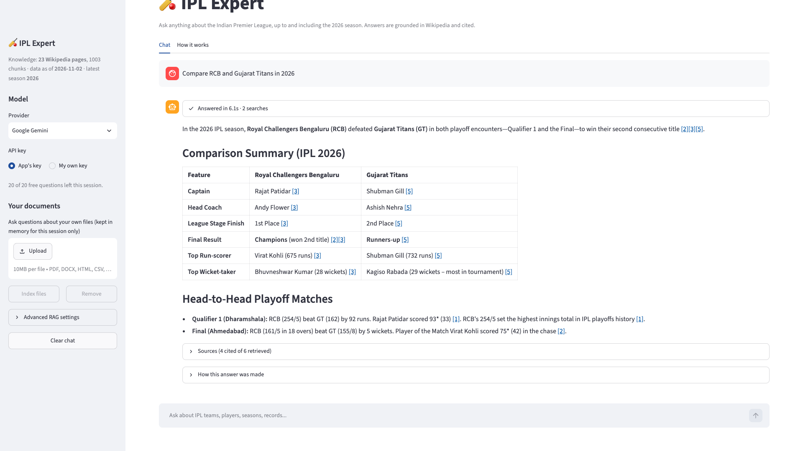
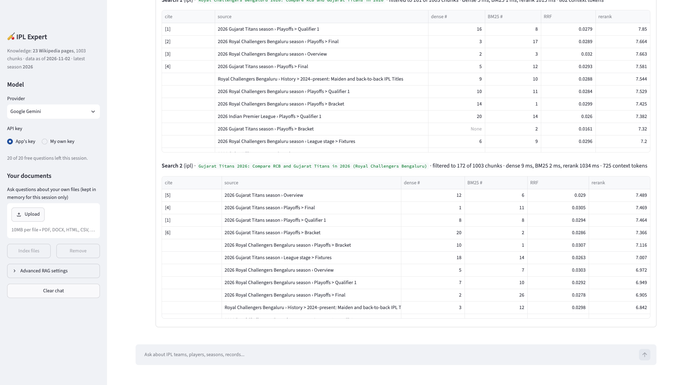
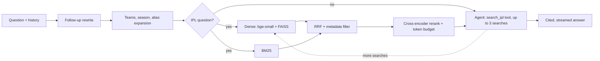

# 🏏 IPL Expert: RAG over a live Wikipedia snapshot

[](https://ipl-rag.streamlit.app)
[](https://github.com/sniper7jd/ipl_rag_system/actions/workflows/ci.yml)
[](https://github.com/sniper7jd/ipl_rag_system/actions/workflows/refresh-knowledge.yml)

Ask anything about the Indian Premier League, up to and including the **2026 season** (squads, captains,
coaches, results, points tables, records). Every answer is grounded in Wikipedia, cites its sources, and shows
exactly how it was produced.

**Try it:** [ipl-rag.streamlit.app](https://ipl-rag.streamlit.app). No setup needed; bring your own Gemini key for unlimited use.



## What makes it more than a demo

| Stage | Technique | Why |
|---|---|---|
| Ingestion | MediaWiki **parse API** with table + infobox extraction (23 pages: all 10 franchises, all 10 *2026 season* pages, league history) | Squads, points tables and results live in tables, which plain-text extracts drop |
| Chunking | **Structure-aware chunks with breadcrumb headers** (`2026 Chennai Super Kings season > Squad`); tables split by rows with column names repeated | A chunk stays findable and self-describing even when its body never names the team or season (lightweight *contextual retrieval*) |
| Embeddings | `BAAI/bge-small-en-v1.5` on **ONNX Runtime** via FastEmbed | Strong small retriever, no PyTorch: 676 MB install vs 1.6 GB, ~0.8 GB peak RAM |
| Retrieval | **Hybrid search**: FAISS (dense) + BM25 (sparse) fused with **Reciprocal Rank Fusion** | Meaning *and* exact names/numbers, without tuning score scales |
| Query understanding | Team-alias + season detection ("RCB this season" → *Royal Challengers Bengaluru*, *2026*), **alias expansion**, **metadata filters** with fallback, **LLM rewrite of follow-ups** (structured output) | Turns vague chat into precise, filterable searches |
| Precision | **Cross-encoder reranking**, near-duplicate suppression, **context token budget** (~3k) | Best ~6 chunks; predictable cost and latency |
| Agent | LangChain 1.x `create_agent` with a `search_ipl(query, team, season)` tool, **forced retrieval** for IPL questions, **query decomposition** for multi-team questions, ≤3 searches | Never answers IPL facts from stale model memory; handles comparisons and multi-part questions |
| Generation | Numbered **citations linked to the exact Wikipedia section**, streamed output, "say what's missing" instead of guessing | Verifiable answers |
| Reliability | **Model fallback chain** (Gemini 3.5 Flash → 2.5 Flash → 3.1 Flash-Lite), tool-call limit, per-session cap, answer cache | Survives provider overloads and free-tier quotas |
| Observability | "How this answer was made" panel: rewritten query, filters, dense/BM25/RRF/rerank scores per chunk, timings, tokens. Optional LangSmith tracing | Shows *why* each answer is what it is |
| Freshness | Weekly GitHub Action rebuilds the snapshot, **only commits if the evaluation still passes**, and Streamlit redeploys on push | Stays current without hand-holding |





## Evaluation

30 hand-written questions with known answers ([eval/golden_2026.yaml](eval/golden_2026.yaml)) covering the
2026 season, team seasons, matches, transfers, squads, history, franchises, and *current* staff (post-season changes).
A retrieval "hit" means a chunk containing the answer is in the top k. Each row adds one technique:

| Method | Hit@1 | Hit@5 | MRR@10 | Avg latency |
|---|---|---|---|---|
| Dense only (bge-small + FAISS) | 40% | 70% | 0.532 | 3 ms |
| BM25 only | 30% | 60% | 0.433 | 0 ms |
| Hybrid (RRF) | 43% | 70% | 0.548 | 3 ms |
| Hybrid + rerank | 57% | 83% | 0.683 | 789 ms |
| **Hybrid + rerank + query understanding** (what the app uses) | **63%** | **97%** | **0.778** | 826 ms |

Run it yourself (no API key needed): `python scripts/eval_retrieval.py`. CI fails a PR if the full pipeline drops
more than 5 points below [eval/baseline.json](eval/baseline.json).

End-to-end answer quality is graded by an LLM judge for **correctness** against the reference and **groundedness**
(every claim supported by the retrieved sources): `python scripts/eval_answers.py`, or run the
*Evaluate answers* workflow. A first run on 2026-11-02 graded all 8 questions it completed as correct and grounded
before the Gemini free-tier quota ran out. The workflow writes the full results to `eval/results_answers.json`,
and the app's *How it works* tab displays them.

## Run locally

```bash
git clone https://github.com/sniper7jd/ipl_rag_system.git
cd ipl_rag_system
python -m venv .venv && source .venv/bin/activate      # Python 3.11+
pip install -r requirements.txt
echo 'GOOGLE_API_KEY=your-key' > .env                   # free key: https://aistudio.google.com/apikey
streamlit run web_app.py                                # or: python main.py "Who won IPL 2026?"
```

The knowledge snapshot ships in [knowledge/](knowledge/), so the app starts in seconds. Rebuild it from
Wikipedia with `python scripts/build_knowledge.py` (add `--season 2027` once next season's pages exist).

## Deploy your own (Streamlit Community Cloud, free)

1. Fork this repo, then go to [share.streamlit.io](https://share.streamlit.io) → **Create app** → *Deploy a public app from GitHub*.
2. Repository `<you>/ipl_rag_system`, branch `main`, main file `web_app.py`; under *Advanced settings* pick Python 3.11.
3. Paste your key into **Secrets** (see [.streamlit/secrets.toml.example](.streamlit/secrets.toml.example)):
   ```toml
   GOOGLE_API_KEY = "your-gemini-key"
   ```
4. Optional: add the same `GOOGLE_API_KEY` as a GitHub Actions secret to enable the *Evaluate answers* workflow.

**About free-tier quotas:** Gemini's free tier is limited per model, per minute *and* per day (as low as 20 requests/day
for some models). The app spreads load across a fallback chain and caps each visitor at 20 questions on the shared key,
but a popular public deployment should use a billing-enabled key (a typical answer is ~2k input tokens) or ask
visitors to paste their own key in the sidebar.

## Configuration

[config.yaml](config.yaml) sets the defaults; the sidebar's *Advanced RAG settings* changes them per session
(retrieval mode, reranker, filters, top-k, token budget, max searches, chunking strategy, model). Model names come from
environment variables (`GEMINI_MODEL`, `GEMINI_FALLBACK_MODEL`, `GROQ_MODEL`, ...). OpenAI, Groq and Claude
appear automatically when their keys are set. Set `RAG_ADMIN=1` locally to save sidebar settings back to `config.yaml`.

## Project structure

```
web_app.py                 Streamlit UI (chat, citations, trace panel, uploads, How it works)
main.py                    Same pipeline from the command line
src/
  loaders/wikipedia.py     Parse-API loader: sections, wikitables (row/colspan), infoboxes
  chunking/structured.py   Breadcrumb-headed section + table-row chunking (+ legacy strategies)
  knowledge/               KnowledgeBase (FAISS + BM25 + team/season indexes), build/load snapshot
  retrieval/query.py       Team aliases, season resolution, expansion, follow-up rewriting
  retrieval/hybrid.py      Dense + BM25 → RRF → filters → dedupe → rerank → token budget, with trace
  retrieval/rerank.py      FastEmbed cross-encoder
  agents/rag_agent.py      Router, create_agent + search tools, citations, streaming events
  llms/                    Gemini / OpenAI / Groq / Claude with fallbacks
  ingestion/loaders.py     PDF / DOCX / HTML / CSV / TXT loaders for per-session uploads
knowledge/                 Committed snapshot: pages.jsonl, chunks.jsonl, faiss.index, manifest.json
eval/                      Golden questions, baseline, results
scripts/                   build_knowledge.py, eval_retrieval.py, eval_answers.py
tests/                     Offline unit tests (parsing, chunking, query understanding, RRF, filters, citations)
.github/workflows/         CI, weekly knowledge refresh, answer evaluation
```

`requirements-legacy.txt` adds the original LangChain-community strategies (semantic chunking, Ensemble/BM25
retrievers, Chroma/Pinecone). Those packages are being sunset upstream, so the app doesn't depend on them.

## Known limitations

- The knowledge base is Wikipedia only: ball-by-ball stats and very recent news may be missing or lag by up to a week.
- The cross-encoder runs on CPU (~0.8 s per search on the free Streamlit tier); answers typically take 3-7 s.
- Questions spanning distant eras in one sentence (e.g. "who won in 2026 and who captained the 2008 winners?") sometimes
  get a partial answer; asking them separately works better.
